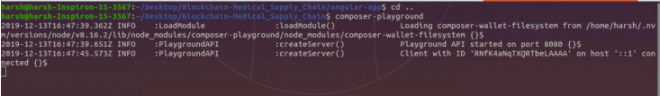
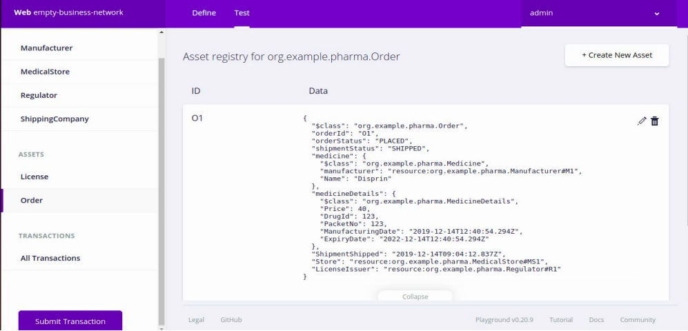
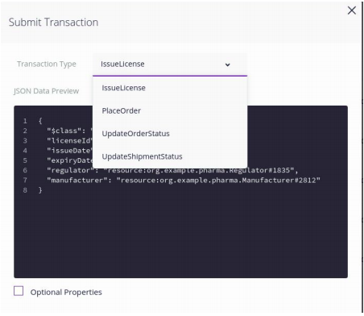
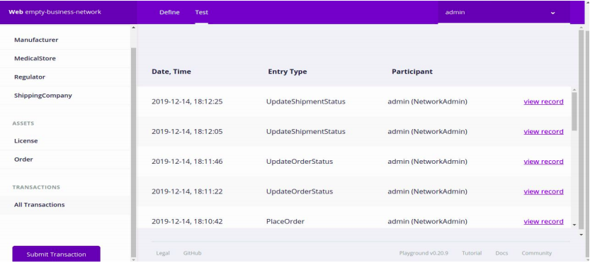
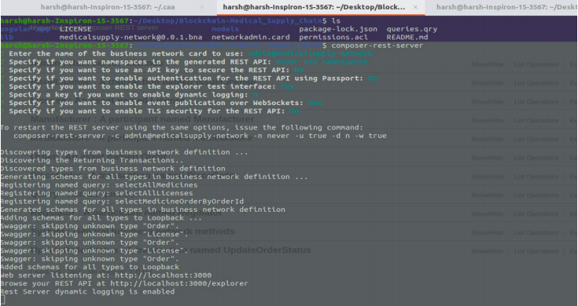
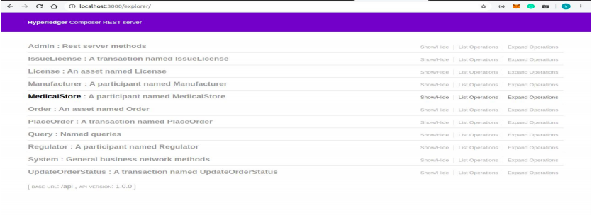
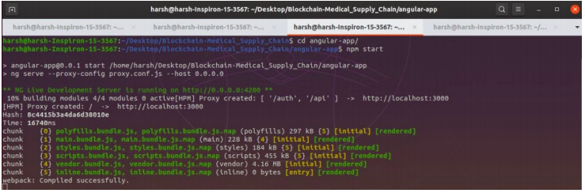
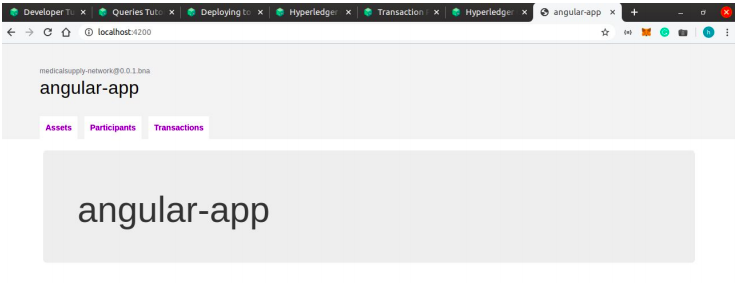
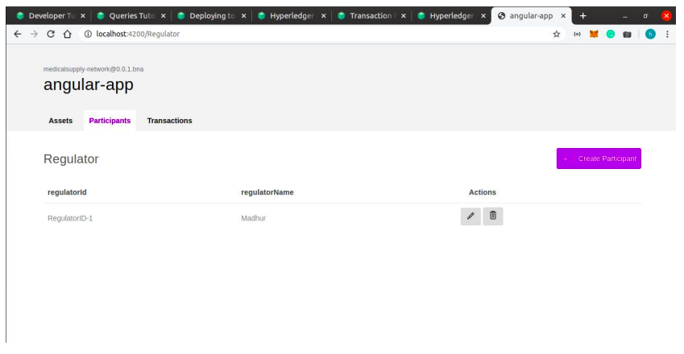

# Medical supply chain on Hyperledger Fabric

A permissioned network for a medicine’s path from regulator to patient. Each order keeps an immutable record of the license, the drug, the price, the pharmacy, and the shipment. The model is a Hyperledger Composer business network (`medicalsupply-network`) on Fabric 1.2, with a Composer REST API and an Angular client.

A public chain cannot show one pharmacy a wholesale price and another a retail price without both parties seeing the difference. This network uses participants and an access-control file so those prices stay with the parties who are allowed to see them.

## Participants and assets

Defined in `models/org.example.pharma.cto`.

| Kind | Name | Role |
| --- | --- | --- |
| Participant | Regulator | Issues a manufacturing license |
| Participant | Manufacturer | Creates the medicine record and ships it |
| Participant | Medical store | Places the order and receives the drug |
| Participant | Shipping company | Moves the shipment |
| Asset | License | License id, issue date, expiry, issuer, manufacturer |
| Asset | Order | Medicine, price, drug id, packet number, dates, order status, shipment status |

Order status is `PLACED`, `SCHEDULED_FOR_MANUFACTURE`, or `DELIVERED`. Shipment status is `SHIPPED`, `ONWAY`, `ARRIVED`, or `DELIVERED`.

Transactions in the model: issue a license, place an order, update order status, update shipment status. Access rules are in `permissions.acl`. Named queries are in `queries.qry`. Transaction logic is in `lib/index.js`.

## Repository

| Path | What it is |
| --- | --- |
| `models/org.example.pharma.cto` | Participants, assets, and transactions |
| `lib/index.js` | Transaction functions |
| `permissions.acl` | Who can see and change which records |
| `queries.qry` | Composer queries |
| `angular-app/` | Angular client for the deployed REST API |

## Versions used for this proof of concept

| Component | Version |
| --- | --- |
| Hyperledger Fabric | 1.2 |
| Composer Playground and Composer REST Server | matching Composer release for Fabric 1.2 |
| Node.js | 8.11.4 |
| Docker Engine | 18.06.1-ce |
| Docker Compose | 1.13.0 |
| Operating system | Ubuntu 18.04 |

These versions are what the project was built against. Current Fabric and Composer releases are not drop-in replacements.

## Walkthrough

Start Composer Playground and open the business network.

Participants are on the upper left, then assets, then transactions. An order shows its drug id, price, and shipment.

Issue a license, place an order, or update order and shipment status from the transaction forms.

Generate the REST API for the `medicalsupply-network` and open it on port 3000. The generated explorer exposes GET and POST for participants, assets, and transactions.

The Angular app talks to that API and is the screen a user would see after deployment. From `angular-app/`:

The dev server listens on port 4200.

